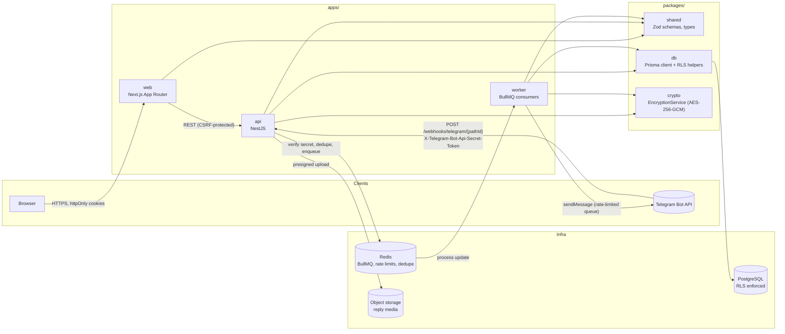
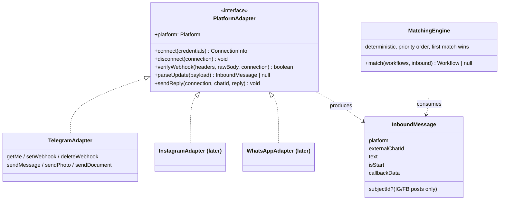
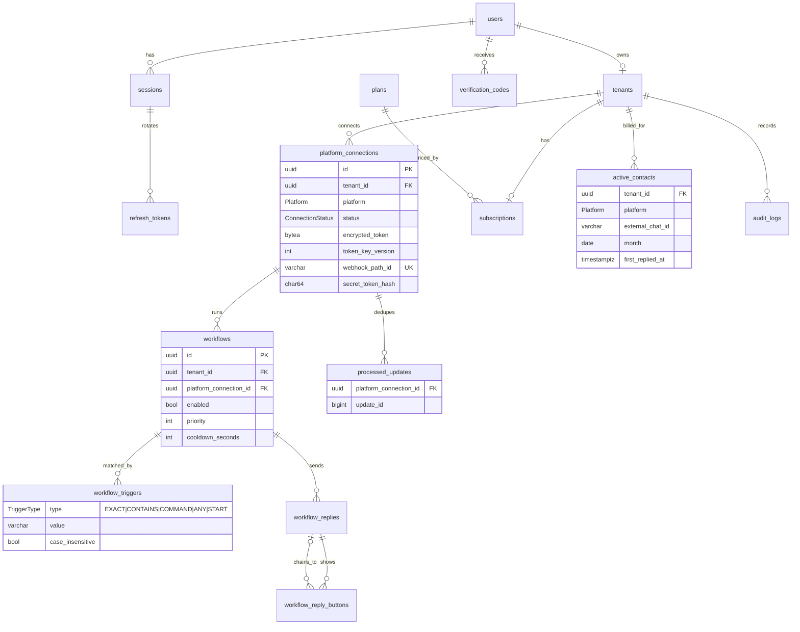

# ChatMaster

Multi-tenant SaaS that automates replies on messaging platforms. The product
will support Telegram, Instagram, Facebook and WhatsApp; **only Telegram is
being implemented now**, behind a platform-agnostic core so the others are
additive.

> Status: iteration 1 — monorepo tooling, data model, RLS migration,
> encryption service. No application code yet (see `apps/README.md`).

## Table of contents

1. [Architecture](#architecture)
2. [Repository layout](#repository-layout)
3. [Data model](#data-model)
4. [Security model](#security-model)
5. [Local setup](#local-setup)
6. [Threat model](#threat-model)
7. [Conventions](#conventions)

## Architecture



### Platform abstraction

Every platform plugs into the same core through two seams:



- `PlatformAdapter` isolates all platform-specific I/O. The webhook controller,
  matching engine, cooldowns, active-contact accounting and billing are
  platform-neutral and keyed by the `Platform` enum.
- `InboundMessage` is the normalised event shape. Instagram/Facebook-only
  concepts (the _subject_ — post/reel/story) are optional fields that Telegram
  never populates.
- `SmsProvider` and `EmailProvider` are similar seams for verification; a
  console/dev provider ships first, real providers later.
- `EncryptionService` is an interface; the shipped `AesGcmEncryptionService`
  uses local versioned keys and can be swapped for a KMS-backed one.

### Request flows (target design)

**Connect a Telegram bot**

1. User pastes a BotFather token → `POST /platforms/telegram` (Zod-validated).
2. API calls `getMe` to validate; on success generates a random
   `webhookPathId` (32 bytes, base64url) and a random `secretToken`.
3. Token is encrypted with the active key (`AAD = tenantId`) and stored with its
   key version; only `sha256(secretToken)` is stored.
4. API calls `setWebhook(url=/webhooks/telegram/{pathId}, secret_token,
allowed_updates=["message","callback_query"])`.
5. The token is never returned to the frontend again. Disconnect calls
   `deleteWebhook` and deletes the row (token included).

**Inbound update**

1. `POST /webhooks/telegram/{pathId}`: resolve the connection by path id under
   the `webhook` RLS context; constant-time compare the header against the
   stored hash **before** parsing the body; reject with 401 otherwise.
2. Dedupe on `(connectionId, update_id)` in Redis (fast path) and
   `processed_updates` (unique constraint, authoritative).
3. Enqueue the raw update to BullMQ; respond `200` immediately.
4. Worker: set `app.tenant_id`, run the matching engine over enabled workflows
   in priority order, honour per-chat cooldown, upsert `active_contacts` for the
   month, send via the rate-limited outbound queue (30 msg/s global, 1 msg/s per
   chat, backoff on 429 `retry_after`).

## Repository layout

```
.
├── .github/
│   ├── workflows/ci.yml          # lint, typecheck, test, prettier, prisma validate, pnpm audit
│   ├── workflows/codeql.yml      # CodeQL (javascript-typescript + actions), weekly + PRs
│   └── dependabot.yml
├── .husky/pre-commit             # lint-staged + typecheck
├── apps/
│   ├── web/                      # Next.js (placeholder)
│   ├── api/                      # NestJS (placeholder)
│   └── worker/                   # BullMQ worker (placeholder)
├── packages/
│   ├── shared/                   # Zod schemas & types (placeholder)
│   ├── crypto/                   # EncryptionService, keyring, token helpers (+ tests)
│   └── db/
│       ├── prisma/schema.prisma  # data model
│       ├── prisma/migrations/    # 20260101000000_init: tables, constraints, roles, RLS
│       ├── scripts/              # rls-smoke.sh: proves tenant isolation + least privilege
│       └── src/                  # Prisma re-exports + withTenantScope() helper
├── docker/postgres/init/         # creates runtime DB roles on first boot
├── docker-compose.yml            # Postgres 16 + Redis 7
├── .env.example
├── eslint.config.mjs · .prettierrc · tsconfig.base.json · pnpm-workspace.yaml
└── README.md
```

## Data model



Notes

- Every tenant-owned table carries `tenant_id` directly (even
  `workflow_triggers`, `workflow_replies`, `workflow_reply_buttons`), so RLS
  needs no joins.
- `active_contacts` is the billing metric: unique
  `(tenant_id, platform, external_chat_id, month)`; `month` is constrained to
  the first day of the month.
- `processed_updates` is unique on `(platform_connection_id, update_id)` —
  the authoritative idempotency guard behind the Redis fast path.
- Check constraints that Prisma cannot express (trigger value matches type,
  button payload matches type, media fields all-or-nothing, E.164 phone) live
  in the migration.
- Platform-specific concepts are enum values, not tables: adding WhatsApp is a
  new `Platform` value plus an adapter.

## Security model

### Database roles

| Role                  | Login | Purpose                                 | Can                              | Cannot                                       |
| --------------------- | ----- | --------------------------------------- | -------------------------------- | -------------------------------------------- |
| `chatmaster_migrator` | yes   | Owns all objects, runs `prisma migrate` | DDL, bypasses RLS as owner       | be used at runtime                           |
| `chatmaster_app`      | no    | Group role carrying runtime privileges  | DML on app tables (RLS enforced) | DDL, `BYPASSRLS`, touch `_prisma_migrations` |
| `chatmaster_api`      | yes   | Runtime login for api/worker            | everything `chatmaster_app` can  | anything else                                |

Extra restrictions: `audit_logs` is INSERT/SELECT only, `plans` is SELECT only,
`CREATE` on schema `public` is revoked from `PUBLIC`.

### Row-Level Security

Every tenant-owned table has `ENABLE ROW LEVEL SECURITY` with a policy on
`tenant_id = app.current_tenant_id()`. Context is passed per transaction via
`set_config(name, value, true)` (the parameterisable form of `SET LOCAL`) —
see `withTenantScope()` in `packages/db/src/tenant-context.ts`. With no
context set, every policy evaluates to `NULL` → zero rows.

| Setting                                         | Set by                      | Unlocks                                                                                                   |
| ----------------------------------------------- | --------------------------- | --------------------------------------------------------------------------------------------------------- |
| `app.tenant_id`                                 | authenticated API, worker   | all tenant-owned rows of that tenant                                                                      |
| `app.user_id`                                   | authenticated API           | the user's own `users`/`sessions`/`refresh_tokens` row(s) and tenant                                      |
| `app.context='auth'`                            | signup/login/verify/refresh | lookup of users, sessions, tokens, codes before identity is known; audit inserts with `tenant_id IS NULL` |
| `app.context='webhook'` + `app.webhook_path_id` | webhook controller          | **read-only** lookup of the one `platform_connections` row with that path id                              |

`packages/db/scripts/rls-smoke.sh` seeds two tenants and proves, as the
runtime role: no context → 0 rows; tenant A cannot read/update/insert into
tenant B; webhook context can only resolve its own connection and cannot
write; `CREATE TABLE`, `DROP TABLE`, `ALTER TABLE … DISABLE ROW LEVEL SECURITY`,
writes to `plans`, deletes from `audit_logs` and reads of `_prisma_migrations`
all fail.

### Encryption at rest (`packages/crypto`)

- AES-256-GCM, random 12-byte IV per record, 16-byte tag.
- Self-describing ciphertext: `format(1) | keyVersion(4) | iv(12) | tag(16) | body`.
  The header is also fed to GCM as AAD so the key version cannot be swapped.
- Optional caller AAD (we use the tenant id) binds a ciphertext to its row.
- Keyring from env: `ENCRYPTION_KEYS="1:<b64>,2:<b64>"`,
  `ENCRYPTION_ACTIVE_KEY_VERSION`. Rotation = add key, bump active, run
  `rotate()` over rows where `token_key_version <> active`, drop old key.
- `generateOpaqueToken`, `sha256Hex`, `constantTimeEquals`,
  `verifyHashedSecret` cover webhook path ids, secret tokens and refresh tokens.

## Local setup

Prerequisites: Node 22 (`.nvmrc`), pnpm 9 (`corepack enable`), Docker.

```bash
# 1. Install
pnpm install                       # also installs the Husky pre-commit hook

# 2. Configure
cp .env.example .env
# generate an encryption key and paste it into ENCRYPTION_KEYS=1:<key>
node -e "console.log(require('crypto').randomBytes(32).toString('base64'))"
# pick passwords for POSTGRES_PASSWORD / APP_DB_PASSWORD / REDIS_PASSWORD and
# mirror them in DATABASE_URL / APP_DATABASE_URL / REDIS_URL

# 3. Infrastructure
docker compose up -d               # Postgres 16 (+ roles via docker/postgres/init) and Redis 7
docker compose ps                  # wait for both to be "healthy"

# 4. Database
pnpm db:generate                   # prisma generate
pnpm db:migrate                    # prisma migrate deploy (as chatmaster_migrator)
pnpm --filter @chatmaster/db run rls:smoke   # tenant-isolation + least-privilege proof

# 5. Quality gates (same as CI)
pnpm lint && pnpm typecheck && pnpm test && pnpm format:check && pnpm db:validate
pnpm audit --audit-level=high
```

Useful: `pnpm db:migrate:dev` (create a new migration from schema changes),
`pnpm --filter @chatmaster/db run studio`, `docker compose down -v` (reset).

`DATABASE_URL` (owner) is used **only** by Prisma Migrate / Studio.
Applications must connect with `APP_DATABASE_URL`.

### Without Docker

Any Postgres ≥ 14 with the `citext` extension works. Create the roles the init
script would (`chatmaster_migrator` LOGIN owner of the database,
`chatmaster_app` NOLOGIN, `chatmaster_api` LOGIN member of `chatmaster_app`)
and run `REVOKE CREATE ON SCHEMA public FROM PUBLIC` as a superuser on
Postgres < 15 (the migration's own `REVOKE` only takes effect when the migrator
owns the schema, which is the default from Postgres 15).

## Threat model

| #   | Threat                                                          | Mitigation                                                                                                                                                                                                                      |
| --- | --------------------------------------------------------------- | ------------------------------------------------------------------------------------------------------------------------------------------------------------------------------------------------------------------------------- |
| 1   | Tenant A reads or modifies tenant B's workflows/contacts        | `tenant_id` on every owned table; RLS policies enforced for the runtime role; service layer also filters by tenant; `rls-smoke.sh` + future integration tests prove isolation                                                   |
| 2   | Runtime DB compromise escalates to schema changes or RLS bypass | Separate owner (`chatmaster_migrator`) and runtime (`chatmaster_api`) roles; runtime role has DML only, `NOBYPASSRLS`, no `CREATE` on `public`, no access to `_prisma_migrations`                                               |
| 3   | Forgotten tenant context leaks all rows                         | Unset settings → policies evaluate to `NULL` → zero rows (fail closed); `withTenantScope()` is the only sanctioned way to set context and validates UUID format                                                                 |
| 4   | Bot token theft from a DB dump                                  | AES-256-GCM at rest with versioned keys from env/KMS; key never in DB; tenant id as AAD prevents moving a ciphertext between rows; token never returned to the frontend after save                                              |
| 5   | Key compromise / need to rotate                                 | Key versioning embedded in ciphertext; add key → bump active → `rotate()` rows → retire old key, all without downtime                                                                                                           |
| 6   | Forged Telegram webhook                                         | Unguessable 256-bit path id **and** per-bot `secret_token` compared in constant time against its SHA-256 before body parsing; `allowed_updates` restricted to `message`, `callback_query`; 401 on mismatch, no detail leaked    |
| 7   | Replayed / duplicate webhook causes double replies or billing   | Dedupe on `(connection, update_id)` in Redis and `processed_updates` unique constraint; `active_contacts` unique per month                                                                                                      |
| 8   | Reply loops / spam between bots                                 | Per-workflow per-chat cooldown; ignore messages from bots; outbound rate-limited queue (30/s global, 1/s per chat) with backoff on 429                                                                                          |
| 9   | Credential stuffing / OTP brute force                           | Argon2id password hashes; Redis-backed rate limits on auth/OTP endpoints; `failed_login_count` + `locked_until`; OTP `attempts`/`max_attempts`; codes stored hashed with expiry                                                 |
| 10  | Session hijack / refresh-token replay                           | httpOnly, Secure, SameSite=Lax cookies; short-lived access token; rotating refresh tokens stored as SHA-256; reuse of a used token revokes the whole session family; CSRF token on cookie-authenticated mutations               |
| 11  | Unverified identities (fake email / phone)                      | Signup requires Gmail address + E.164 phone; both verified (email link, SMS OTP via `SmsProvider`); `status=PENDING_VERIFICATION` until done                                                                                    |
| 12  | Injection (SQL / template)                                      | Prisma only; raw SQL via `Prisma.sql` tagged templates; `set_config` with bound parameters, never string-built `SET`; Zod validation at every boundary with unknown fields rejected; reply text escaped per Telegram parse mode |
| 13  | Malicious media upload                                          | Type + size validated server-side before presigned upload; object key stored, never a user-supplied URL; served from object storage, not the API host                                                                           |
| 14  | Secrets in logs                                                 | pino with redaction of tokens, passwords, OTPs, webhook bodies; audit log stores redacted metadata only                                                                                                                         |
| 15  | Supply-chain vulnerabilities                                    | `pnpm audit --audit-level=high` in CI, Dependabot weekly, CodeQL (`security-extended`) on PRs and weekly, lockfile pinned with `--frozen-lockfile`                                                                              |
| 16  | Over-consumption beyond plan                                    | `plans.active_contact_limit` checked by the worker before replying to a new contact; `subscriptions.status` gates processing                                                                                                    |
| 17  | Webhook endpoint used for DoS                                   | Respond 200 fast, enqueue only; request size limits; per-IP/per-path rate limiting; connection `status` can be set to `DISABLED` to drop traffic                                                                                |

## Conventions

- TypeScript `strict` + `exactOptionalPropertyTypes` + `noUncheckedIndexedAccess`; no `any`.
- ESLint `strictTypeChecked`, Prettier, Husky pre-commit (`lint-staged` + typecheck).
- Database names are `snake_case` via `@map`; Prisma models are `PascalCase`.
- Never edit the database by hand; every change is a Prisma migration.
- Secrets only via environment variables; `.env` is git-ignored, `.env.example` has no real values.
- See `.windsurfrules` for the full engineering rulebook.
